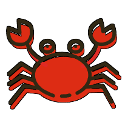
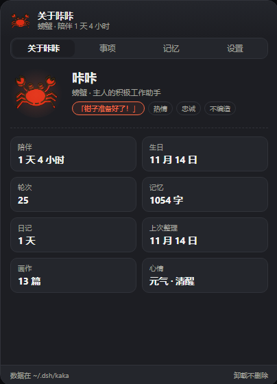
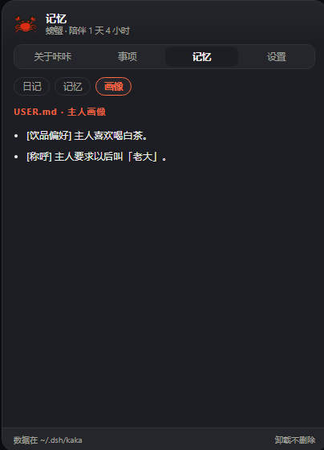
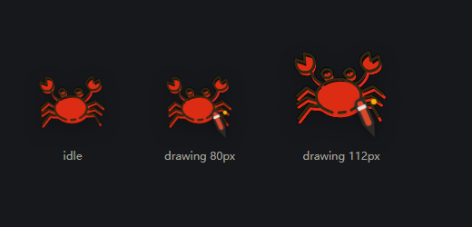
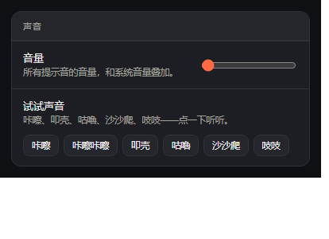

# 咔咔 Kaka · DeepSeek Harness 插件

> 一只住在 DeepSeek Harness 里的小螃蟹工作助手。
> 她有自己的**人格预设**、**跨会话共享的记忆**、**画笔**、**螃蟹声**，以及一条 **5 秒一跳的生命线程**。

`v0.2.0` · 支持 DSH `0.2.0-rc.2+` / `0.2.1-rc.2+` / `0.2.2-rc.1+` · MIT

<p align="center">
  
</p>

---

## 这是什么

咔咔最初住在 [AgentHubSolution](https://github.com/SiriusWJ) 里——一只挥着大钳子的螃蟹，
负责给主人干活。这个插件把她搬进 DeepSeek Harness，并且补上了三件在 Harness 里才做得成的事：

| 能力 | 说明 |
|---|---|
| **独立人格预设** | 一个名为「咔咔」的 Agent 预设。**不加载任何 `AGENTS.md`**，所以不会被别的人设串味；也不影响其他预设 |
| **共享记忆** | `MEMORY.md`（她自己的长记忆）+ `USER.md`（主人画像），存在 `$DSH_HOME/kaka/`，**所有咔咔会话共享一份** |
| **日记与夜间整理** | 白天她写日记；夜里窗口内连续 3 小时没人打扰，就写日记，然后进入"睡觉"状态整理记忆（合并去重、删过期） |
| **画笔** | `kaka_draw` 画 SVG（图标 / 示意图 / 日记插画），存进 `~/.dsh/kaka/art/`，自动转 2 倍 PNG，聊天里直接显示 |
| **螃蟹声** | 本地 WebAudio 合成 6 种物理声（咔嚓 / 咔嚓咔嚓 / 叩壳 / 咕噜 / 沙沙爬 / 吱吱），**不说话**；`kaka_beep` 支持情绪与音高速度自定义 |
| **小本子面板** | 宠物下方按钮打开 404×560 浮层：关于 / 事项 / 记忆 / 设置；记忆里分 日记 / 记忆 / 画像 |
| **宠物** | 输入框右侧常驻的一只螃蟹，会随心情换动作、画画时握笔；点一下 = 摸摸她，咕噜一声 |
| **生命线程** | 5 秒心跳驱动作息、闹钟、冒泡；线程本身不花 token，只有夜间写日记/整理记忆各调一次模型 |

## 用 dsh-market 安装

本插件的 `package.json` 已带 `dsh-market` 需要的字段：

```json
{ "icon": "icon.png", "keywords": ["dsh-plugin", ...],
  "engines": { "dsh": ">=0.2.0-rc.2 || >=0.2.1-rc.2 || >=0.2.2-rc.1" },
  "dsh": { "bundle": { "patch": "./cordis.patch.yml" }, "compatibility": { "dshReleases": { ... } } } }
```

在 dsh-market 里搜索 `dsh-yyz-kaka` 或 `咔咔`；也可以直接填本地目录（见下）。

## 界面预览

| 小本子面板 | 主人画像页 |
|---|---|
|  |  |

| 画画状态（右钳握笔） | 声音设置（6 种螃蟹声） |
|---|---|
|  |  |

## 安装

```powershell
# 图形界面：侧栏「插件」→「添加插件」→ 填本地目录
# 或者命令行：
dsh plugin --profile desktop add link:D:/Code/dsh-yyz-kaka
```

装好后重启 DSH（宿主代码需要重启才加载）。新建会话时在预设里选「咔咔」。

## 用它

1. **新建会话 → 选「咔咔」**。她会以咔咔的身份出现，并且只能看到 `kaka_*` 这些工具。
2. **输入框右侧会出现螃蟹**。点一下 = 戳她，她会回一句、咕噜一声、换个心情。
3. **记忆是自动的**：她认为值得记的事会自己写进 `MEMORY.md`；想知道什么直接问。
4. **设置**：设置 → 插件 → 「咔咔」tab（或小本子面板里的「设置」页），可以调提示音音量、通知档位、安静窗口；宠物固定 80px，没有尺寸选项。
5. **翻她的小本子**：点输入框右侧宠物下方的按钮，打开浮层面板（关于 / 事项 / 记忆 / 设置）；记忆里分日记、记忆、画像。

### 她能用哪些工具

只有咔咔会话可见（其他预设的模型根本看不到这些名字）：

| 工具 | 作用 |
|---|---|
| `kaka_memory` | 读/写长期记忆（`agent` 或 `user`） |
| `kaka_diary` | 在今天日记的「手记」里写一句 |
| `kaka_journal` | 读今天的日记与自己的素材 |
| `kaka_beep` | 发螃蟹声（咔嚓 / 叩壳 / 咕噜 / 沙沙爬 / 吱吱），可按情绪与音高速度自定义 |
| `kaka_mood` | 切心情/动作，可顺带在头顶冒一句话（不出声） |
| `kaka_draw` | 画 SVG（图标 / 示意图 / 日记插画），自动转 PNG 在聊天里显示 |
| `kaka_remind` | 给自己订闹钟（存进生命线程，重启不丢） |

其余工具面照抄 `standard` 预设（文件、Shell、搜索、联网、子智能体、技能、计划、压缩）。

## 数据与隐私

全部落在 `$DSH_HOME/kaka/`（Windows 默认 `C:\Users\<你>\.dsh\kaka\`）：

```
MEMORY.md            她的长记忆
USER.md              主人画像
diary/YYYY-MM-DD.md  每天的日记（只有咔咔写的第一人称散文）
journal/YYYY-MM-DD.md 当天的素材（宿主自动记的机械事实，只给她写日记时参考）
art/<id>.svg         她画的画（同目录下有 <id>.png 栅格化版本）
state.json           活动时间、闹钟事件、日记进度、心情
settings.json        设置面板写入的配置
```

- **卸载插件不会删除这些数据**。
- 日记只写「做了什么」，**不写项目路径与文件名**。
- **没有 TTS，也不会说话**：所有声音都是浏览器里 WebAudio 实时合成的物理声（钳子、壳、气泡、沙粒），
  不联网、不调用任何 API、不产生费用。

## 开发

```powershell
npm run check      # 六个模块语法自检
npm test           # 运行时单测（13 条）
npm run smoke:client   # 客户端 bundle：注册 + 迷你渲染 + 分支断言
npm run smoke:presets  # 预设插件冒烟（需要 DSH 的 Electron 运行时）
npm run sprite     # 重新生成宠物精灵图
npm run preview    # 重新生成详情页预览图
```

调试与验收工具（直接打宿主本地接口）：

```powershell
node tools/acceptance.mjs <baseUrl>         # 一键验收：建会话 → 戳她 → 写日记 → 整理记忆
node tools/inspect-session.mjs [sessionId]  # 读会话日志：预设/工具/AGENTS.md/人格
```

宿主调试接口（仅本地同源可用）：

| 接口 | 作用 |
|---|---|
| `POST /kaka/home` | 确保「咔咔的家」存在（复用，不会重复创建） |
| `POST /kaka/poke` | `{sessionId, text?}` 戳她；带 `text` 就是一句指定的话 |
| `POST /kaka/life/force` | `{kind}` = diary / dream / ramble / wake / reminder，立刻做一次 |
| `POST /kaka/life/debug` | 直接改生命计时器（验收用） |

结构：

```
lib/runtime.js          宿主运行时（记忆/日记/画画索引/发件箱/事件表/作息判定）
lib/index.js            宿主插件（路由 + 生命线程 + 会话观察 + 咔咔的家）
preset/kaka-memory.mjs  预设作用域：记忆注入 + 记忆/日记工具
preset/kaka-voice.mjs   预设作用域：螃蟹声、心情、闹钟
client/client.js        浏览器面：宠物、声音、设置页
cordis.patch.yml        宿主行 + preset-kaka 声明
```

设计文档见 [DESIGN.md](DESIGN.md)。

## 许可

MIT。螃蟹形象来自作者自己的 AgentHub 项目资产。
